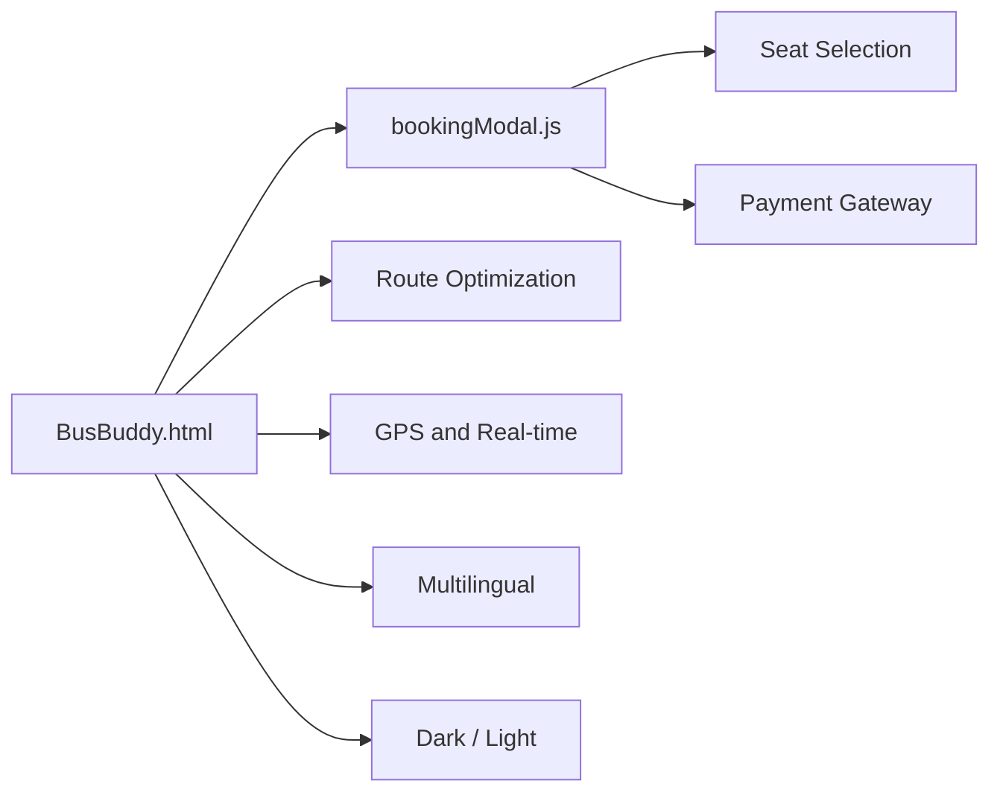

[README (2).md](https://github.com/user-attachments/files/33601367/README.2.md)
# 🚌 Bus Buddy

> **Book it. Track it. Ride it.** A smart bus ticketing web app with live tracking, interactive seat selection and multilingual support.


**[Live Demo](https://YOUR-USERNAME.github.io/Bus-Buddy-Project)** · **[Report Bug](../../issues)** · **[Request Feature](../../issues)**

---

## 📖 Table of Contents

- [The Idea](#-the-idea)
- [Passenger Journey](#-passenger-journey)
- [Modules](#-modules)
- [Architecture](#-architecture)
- [Getting Started](#-getting-started)
- [Configuration](#-configuration)
- [Roadmap](#-roadmap)
- [Contributing](#-contributing)
- [Author](#-author)

---

## 💡 The Idea

Booking a bus seat should not mean phone calls, queues or guessing where the bus is. **Bus Buddy** puts the whole trip in one page: pick a route, choose your exact seat, pay online and follow the bus in real time, in your own language and in light or dark mode.

## 🧭 Passenger Journey

```text
 Search route ──► Compare options ──► Pick seat ──► Pay ──► Track bus live
      │                 │                 │          │            │
   routes          route optimiser     seat map   gateway     GPS module
```

## 🧩 Modules

Each feature lives in its own JavaScript file, so it can be read, tested and replaced independently.

| File | Responsibility |
|---|---|
| `BusBuddy.html` | Main page: layout, styling and module loading |
| `bookingModal.js` | Booking pop-up flow: passenger details, summary and confirmation |
| `newInteractiveSeatSelection.js` | Clickable seat map with available, selected and booked states |
| `newrouteoptimization.js` | Finds and suggests the best route options |
| `newGPSandRealTimeIntegration.js` | Live bus location and real-time trip updates |
| `newpaymentgatewayintegration.js` | Online payment handling for bookings |
| `newmultilingualsupport.js` | Language switching across the interface |
| `newdarklight.js` | Light and dark theme toggle |

## 🏗️ Architecture



## 🚀 Getting Started

**Prerequisites:** any modern browser. No build tools are required.

```bash
# Clone
git clone https://github.com/YOUR-USERNAME/Bus-Buddy-Project.git
cd Bus-Buddy-Project

# Run: open directly, or use a local server
open BusBuddy.html
npx serve .
```

> GPS and payment features may need a local server (`http://localhost`) or HTTPS to work in the browser.

## ⚙️ Configuration

Some modules rely on third-party services. Add your own keys before using them:

| Setting | Where | Notes |
|---|---|---|
| Maps / GPS provider key | `newGPSandRealTimeIntegration.js` | Required for live tracking |
| Payment gateway key | `newpaymentgatewayintegration.js` | Use **test** keys during development |
| Translations | `newmultilingualsupport.js` | Add a new language by adding a new key set |

> ⚠️ Never commit real API or payment keys to a public repository. Use test keys, or load keys from a backend.

## 🗺️ Roadmap

- [x] Interactive seat selection
- [x] Route optimization
- [x] Live GPS tracking
- [x] Payment gateway integration
- [x] Multilingual interface
- [x] Light and dark themes
- [ ] User accounts and booking history
- [ ] E-ticket with QR code
- [ ] Backend and database for real bookings
- [ ] Cancellation and refunds
- [ ] Driver and operator dashboard

## 🤝 Contributing

1. Fork the repository
2. Create a branch: `git checkout -b feature/your-feature`
3. Commit: `git commit -m "Add your feature"`
4. Push: `git push origin feature/your-feature`
5. Open a Pull Request

## 👨‍💻 Author

**S.S. Manikanda Prabu**
B.Tech CSE, SRM Institute of Science and Technology, Ramapuram

[GitHub](https://github.com/YOUR-USERNAME) · [LinkedIn](https://linkedin.com/in/YOUR-PROFILE)

---

<p align="center">Made with ☕ and a lot of bus rides. If this helped, leave a ⭐</p>
